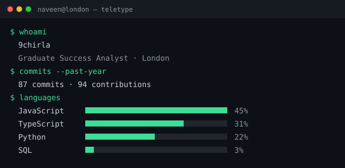

<pre>
     ███╗   ██╗ █████╗ ██╗   ██╗███████╗███████╗███╗   ██╗     
     ████╗  ██║██╔══██╗██║   ██║██╔════╝██╔════╝████╗  ██║     
     ██╔██╗ ██║███████║██║   ██║█████╗  █████╗  ██╔██╗ ██║     
     ██║╚██╗██║██╔══██║╚██╗ ██╔╝██╔══╝  ██╔══╝  ██║╚██╗██║     
     ██║ ╚████║██║  ██║ ╚████╔╝ ███████╗███████╗██║ ╚████║     
     ╚═╝  ╚═══╝╚═╝  ╚═╝  ╚═══╝  ╚══════╝╚══════╝╚═╝  ╚═══╝     

┌─ ● ● ●  naveen@london ──────────────────────────────────────┐
│                                                             │
│ Naveen Reddy Chirla                                         │
│ Graduate Success Analyst & builder · London                 │
│ MBA, University of East London                              │
│                                                             │
│ working on     Jacked is live for rotating shifts.          │
│                A multi-tenant retail product is in the lab. │
│ learning       SQL, metrics, forecasting,                   │
│                stakeholder reporting.                       │
│ ask me about   how a spreadsheet becomes a product          │
│                someone actually uses.                       │
│                                                             │
│ roadmap                                                     │
│   01  SQL a stakeholder can re-run                          │
│   02  one owner for every metric                            │
│   03  forecasts that publish the miss                       │
│   04  reports a phone can open                              │
│                                                             │
│ portfolio      9chirla.github.io                            │
│                                                             │
└─────────────────────────────────────────────────────────────┘
</pre>

<a href="https://9chirla.github.io">9chirla.github.io</a>

## The Arsenal

  <strong>FRONTEND</strong> 
  
  
  
  
  

  <strong>BACKEND</strong> 
  
  
  
  

  <strong>INFRA</strong> 
  
  
  
  
  

  <strong>ANALYTICS</strong> 
  
  
  

## The Signal

### [Jacked](https://github.com/9chirla/jacked)

Rotating shifts drop the training plan the moment the gym loses signal. Offline-first Next.js PWA: a Sunday A/B/A planner, keypad logging, and an IndexedDB outbox that syncs to Supabase when the phone finds a network. [Live](https://jacked-gold.vercel.app)

### [Voyager AI](https://github.com/9chirla/voyager-ai)

Trip planning collapses into a chat thread nobody can hand to a friend. A 10-step wizard streams one itinerary — days, packing, notes — from DeepSeek through Express into React and Vite. [Live](https://9chirla.github.io/voyager-ai/)

### [Applylytics](https://github.com/9chirla/Applylytics)

A CV dies in an ATS and the writer never sees which words were missing. Python and Streamlit return a match score, the missing keywords, hiring-manager coaching, and a Word file ready to send. Groq and Gemini sit behind the coaching.

## The Telemetry

The streak is live. The teletype and the snake are rewritten every six hours. The board updates when a visitor submits a move.

  <picture>
    <source media="(prefers-color-scheme: dark)" srcset="https://streak-stats.demolab.com/?user=9chirla&theme=transparent&hide_border=true&border_radius=0&ring=3DDC97&fire=F0883E&currStreakNum=3DDC97&sideNums=C9D1D9&currStreakLabel=8B949E&sideLabels=8B949E&dates=6E7681" />
    
  </picture>

  

  <picture>
    <source media="(prefers-color-scheme: dark)" srcset="https://raw.githubusercontent.com/9chirla/9chirla/main/assets/github-contribution-grid-snake-dark.svg" />
    
  </picture>

Play the board

<!-- chess:start -->
**White to move.**

<pre>
8  ♜ ♞ ♝ ♛ ♚ ♝ ♞ ♜
7  ♟ ♟ ♟ ♟ ♟ ♟ ♟ ♟
6  · · · · · · · ·
5  · · · · · · · ·
4  · · · · · · · ·
3  · · · · · · · ·
2  ♙ ♙ ♙ ♙ ♙ ♙ ♙ ♙
1  ♖ ♘ ♗ ♕ ♔ ♗ ♘ ♖
   a b c d e f g h
</pre>

Click a destination. GitHub opens an issue. The workflow plays the move and closes it.

| From | To |
| --- | --- |
| A2 | [A3](https://github.com/9chirla/9chirla/issues/new?title=Chess%3A%20Move%20A2%20to%20A3&body=Submit%20this%20issue.%20Leave%20the%20title%20exactly%20as%20it%20is.) · [A4](https://github.com/9chirla/9chirla/issues/new?title=Chess%3A%20Move%20A2%20to%20A4&body=Submit%20this%20issue.%20Leave%20the%20title%20exactly%20as%20it%20is.) |
| B1 | [A3](https://github.com/9chirla/9chirla/issues/new?title=Chess%3A%20Move%20B1%20to%20A3&body=Submit%20this%20issue.%20Leave%20the%20title%20exactly%20as%20it%20is.) · [C3](https://github.com/9chirla/9chirla/issues/new?title=Chess%3A%20Move%20B1%20to%20C3&body=Submit%20this%20issue.%20Leave%20the%20title%20exactly%20as%20it%20is.) |
| B2 | [B3](https://github.com/9chirla/9chirla/issues/new?title=Chess%3A%20Move%20B2%20to%20B3&body=Submit%20this%20issue.%20Leave%20the%20title%20exactly%20as%20it%20is.) · [B4](https://github.com/9chirla/9chirla/issues/new?title=Chess%3A%20Move%20B2%20to%20B4&body=Submit%20this%20issue.%20Leave%20the%20title%20exactly%20as%20it%20is.) |
| C2 | [C3](https://github.com/9chirla/9chirla/issues/new?title=Chess%3A%20Move%20C2%20to%20C3&body=Submit%20this%20issue.%20Leave%20the%20title%20exactly%20as%20it%20is.) · [C4](https://github.com/9chirla/9chirla/issues/new?title=Chess%3A%20Move%20C2%20to%20C4&body=Submit%20this%20issue.%20Leave%20the%20title%20exactly%20as%20it%20is.) |
| D2 | [D3](https://github.com/9chirla/9chirla/issues/new?title=Chess%3A%20Move%20D2%20to%20D3&body=Submit%20this%20issue.%20Leave%20the%20title%20exactly%20as%20it%20is.) · [D4](https://github.com/9chirla/9chirla/issues/new?title=Chess%3A%20Move%20D2%20to%20D4&body=Submit%20this%20issue.%20Leave%20the%20title%20exactly%20as%20it%20is.) |
| E2 | [E3](https://github.com/9chirla/9chirla/issues/new?title=Chess%3A%20Move%20E2%20to%20E3&body=Submit%20this%20issue.%20Leave%20the%20title%20exactly%20as%20it%20is.) · [E4](https://github.com/9chirla/9chirla/issues/new?title=Chess%3A%20Move%20E2%20to%20E4&body=Submit%20this%20issue.%20Leave%20the%20title%20exactly%20as%20it%20is.) |
| F2 | [F3](https://github.com/9chirla/9chirla/issues/new?title=Chess%3A%20Move%20F2%20to%20F3&body=Submit%20this%20issue.%20Leave%20the%20title%20exactly%20as%20it%20is.) · [F4](https://github.com/9chirla/9chirla/issues/new?title=Chess%3A%20Move%20F2%20to%20F4&body=Submit%20this%20issue.%20Leave%20the%20title%20exactly%20as%20it%20is.) |
| G1 | [F3](https://github.com/9chirla/9chirla/issues/new?title=Chess%3A%20Move%20G1%20to%20F3&body=Submit%20this%20issue.%20Leave%20the%20title%20exactly%20as%20it%20is.) · [H3](https://github.com/9chirla/9chirla/issues/new?title=Chess%3A%20Move%20G1%20to%20H3&body=Submit%20this%20issue.%20Leave%20the%20title%20exactly%20as%20it%20is.) |
| G2 | [G3](https://github.com/9chirla/9chirla/issues/new?title=Chess%3A%20Move%20G2%20to%20G3&body=Submit%20this%20issue.%20Leave%20the%20title%20exactly%20as%20it%20is.) · [G4](https://github.com/9chirla/9chirla/issues/new?title=Chess%3A%20Move%20G2%20to%20G4&body=Submit%20this%20issue.%20Leave%20the%20title%20exactly%20as%20it%20is.) |
| H2 | [H3](https://github.com/9chirla/9chirla/issues/new?title=Chess%3A%20Move%20H2%20to%20H3&body=Submit%20this%20issue.%20Leave%20the%20title%20exactly%20as%20it%20is.) · [H4](https://github.com/9chirla/9chirla/issues/new?title=Chess%3A%20Move%20H2%20to%20H4&body=Submit%20this%20issue.%20Leave%20the%20title%20exactly%20as%20it%20is.) |

[Start a new game](https://github.com/9chirla/9chirla/issues/new?title=Chess%3A%20Start%20new%20game&body=Submit%20this%20issue.%20Leave%20the%20title%20exactly%20as%20it%20is.)
<!-- chess:end -->

## The Handshake

  
  
  

